# git-shuttle

[](https://github.com/adityaoryza/git-shuttle/actions/workflows/ci.yml)
[](https://github.com/adityaoryza/git-shuttle/releases/latest)
[](LICENSE)

**The same steps, in the same order, with the same checks, every time you take a branch from your work to the integration
branch and to a release.** One command instead of a copied list of ten.

> ### Install in one line
>
> ```bash
> curl -fsSL https://github.com/adityaoryza/git-shuttle/raw/main/install.sh | bash
> ```
>
> Then, inside any repository: **`git shuttle ui`** opens the web page, **`git shuttle --help`** lists the commands.
> Works on Linux, macOS (bash 4.4+) and WSL2. Other ways and options: [Install](#install).

```
$ git shuttle merge
repository: acme-shop (/home/me/acme-shop)
branch:     feat/invoice-total
merge into: develop  (noff)
steps:      fetch, rebase on origin/develop, push feat/invoice-total, update develop, merge, push develop, back to feat/invoice-total
Ship 'feat/invoice-total' to 'develop'? [Y/n]
$ git fetch --quiet origin
$ git rebase origin/develop
$ git push -u origin feat/invoice-total
$ git checkout develop
$ git pull --ff-only origin develop
$ git merge --no-ff -m "Merge branch 'feat/invoice-total' into develop" feat/invoice-total
$ git push origin develop
$ git checkout feat/invoice-total
==> done: 'feat/invoice-total' is in 'develop' on origin
```

It is a thin layer over git, not a replacement: every command it runs is printed first, and it stops at the first thing that
fails, saying how to go on.

## The web UI at a glance

`git shuttle ui` opens a local page: the commit graph on the left, and the one thing to do next on the right. The same flow as the
commands, with a preview before every run.

| 1. Start a task | 2. Ship: one commit per module |
|---|---|
| 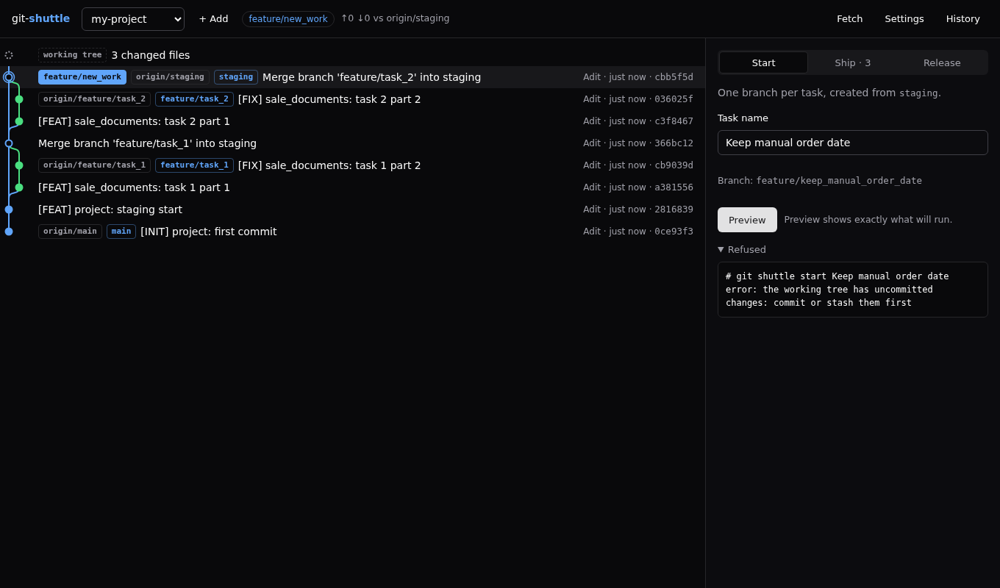 | 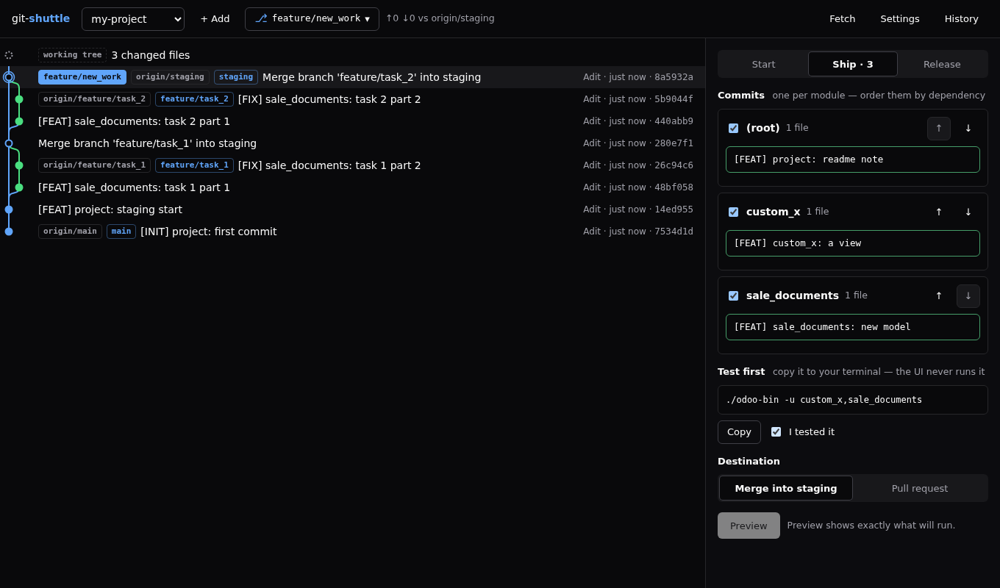 |
| **3. Preview: the exact commands** | **4. Done: the graph shows the merge** |
| 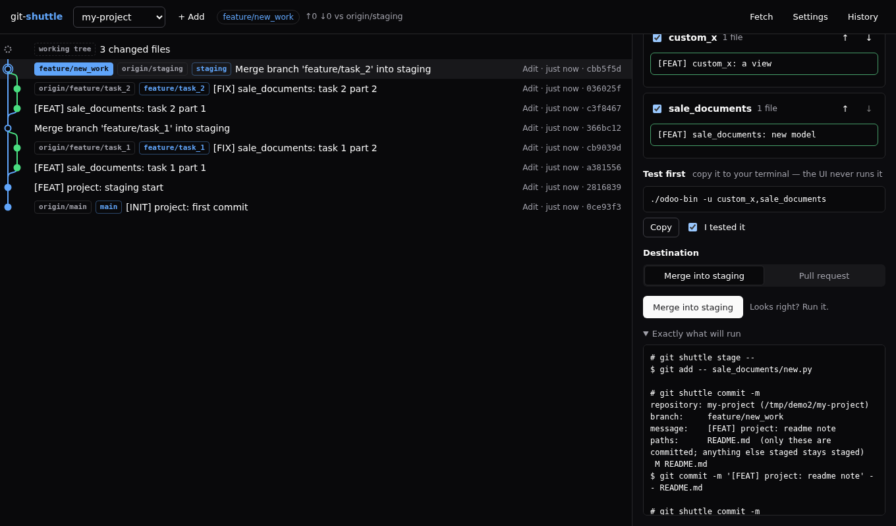 | 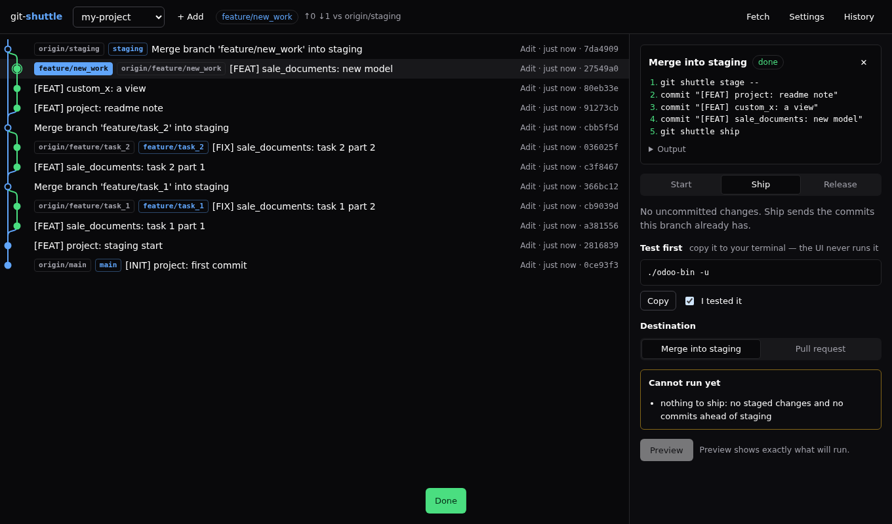 |
| **5. Release: pick commits in order** | **6. Settings per repository** |
| 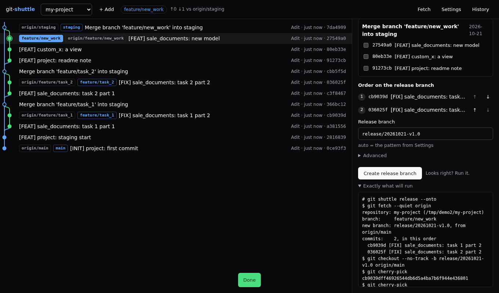 | 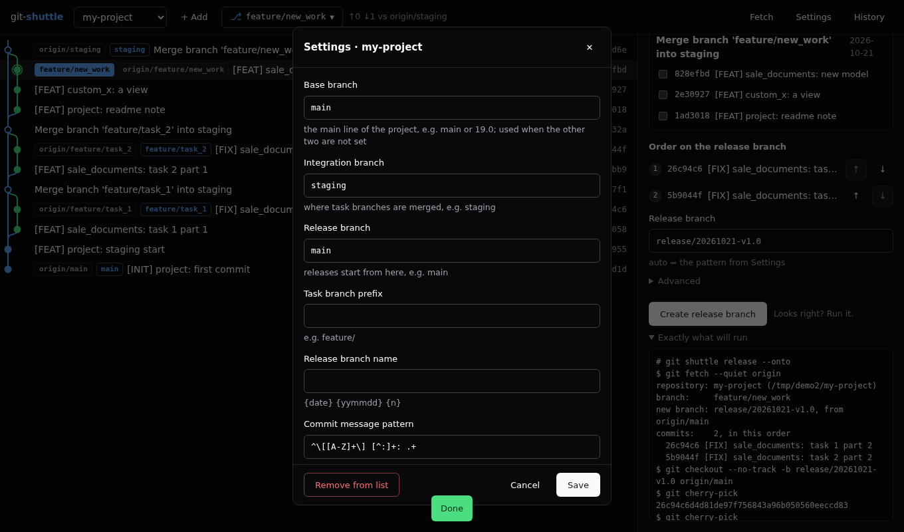 |
| **A conflict stops it, safely** | **Pick the branch, hide what you do not need** |
| 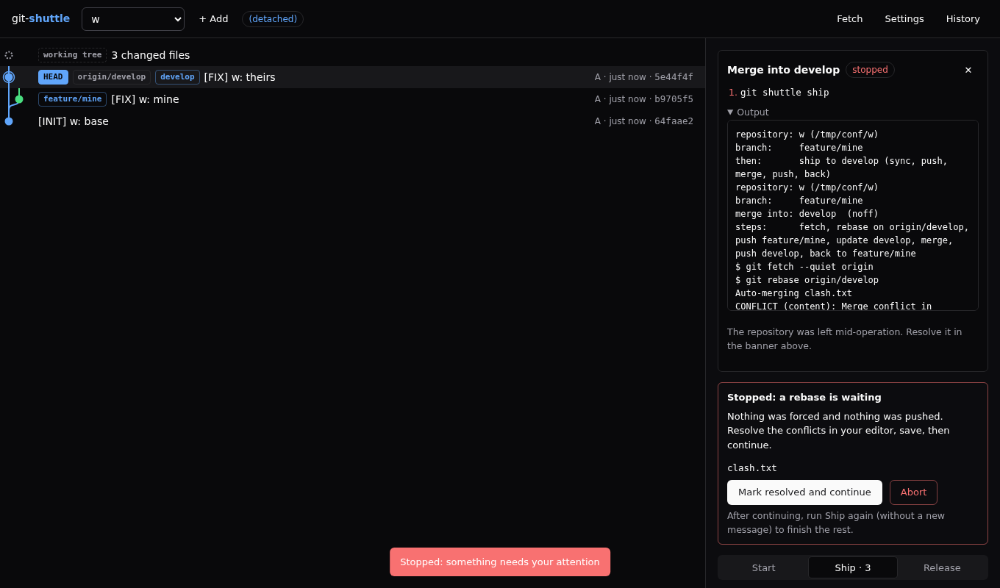 | 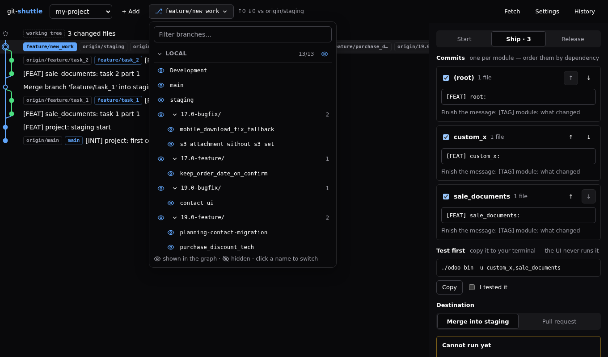 |
| **Right-click a commit** | **Cherry-pick, previewed first** |
| 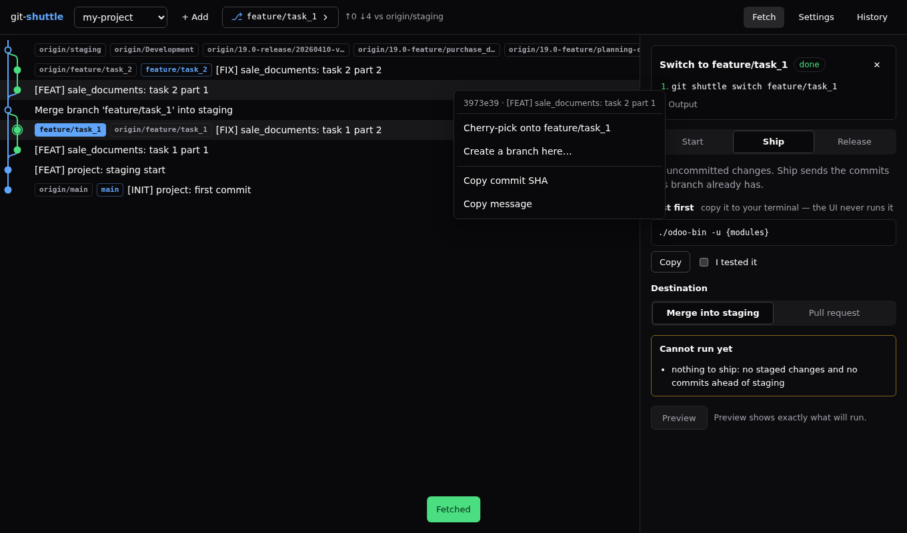 | 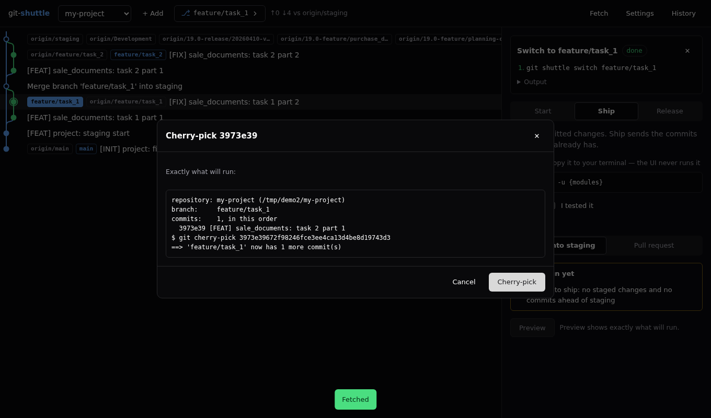 |
| **Click a commit: files and diff** | **Side by side, with syntax colours** |
| 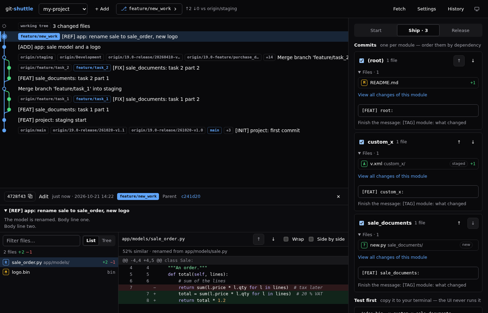 | 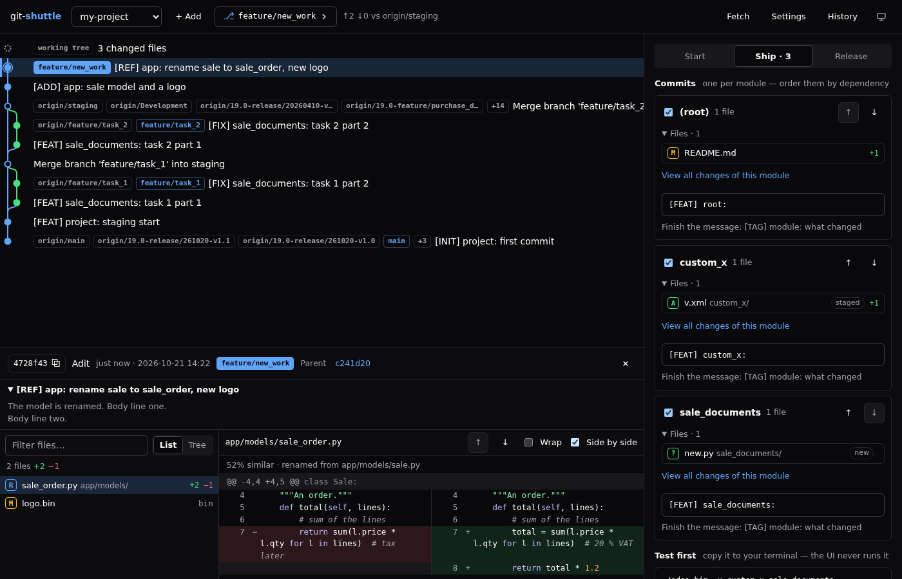 |
| **The working tree, before you commit** | **Light and dark** |
| 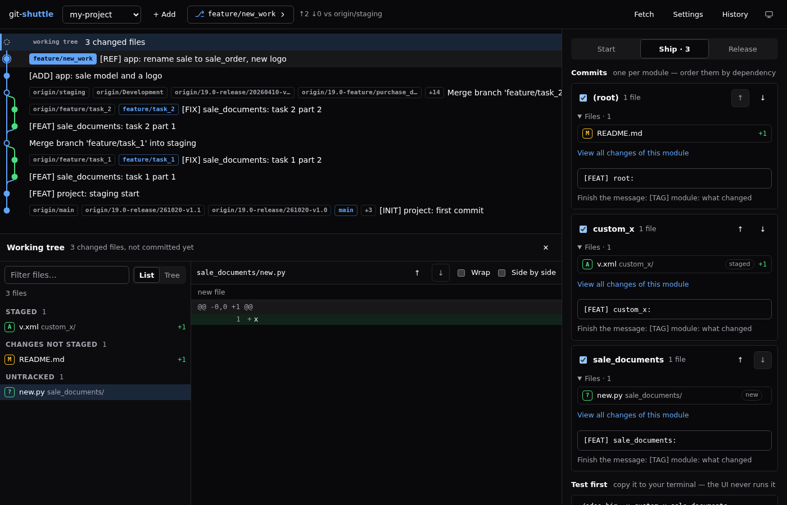 | 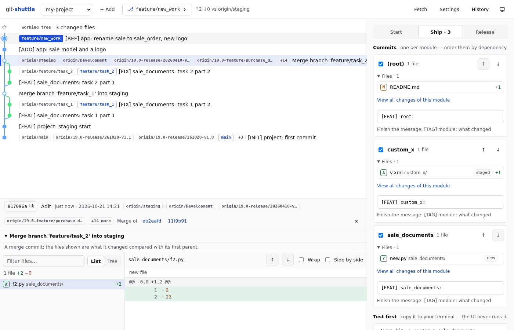 |
| **See what you are about to ship** | **An old server is told** |
| 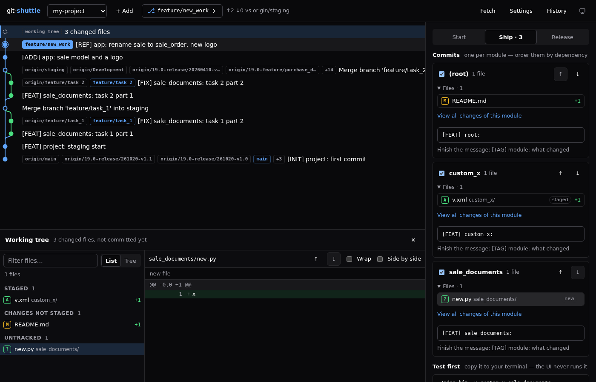 | 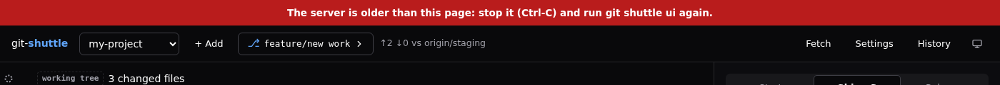 |

### More commands: branches, commits, the stash, undo

All of them show where you are, say what they will do, ask once (`-y` skips the question, `-n` only shows) and refuse before changing anything
when they cannot be done safely: a protected branch, uncommitted changes, an operation waiting for you, or history that is on a remote.

| Command | What it does |
|---|---|
| `git shuttle fetch [--prune] [--all]` | bring the remote's branches up to date; none of yours changes |
| `git shuttle pull [--ff-only \| --rebase \| --merge] [--branch NAME]` | bring a branch up to date with its upstream; `--branch` moves another branch forward without checking it out |
| `git shuttle rename OLD NEW [--remote]` | rename a local branch (and on the remote, with the upstream following) |
| `git shuttle delete BRANCH [--force]`, `delete --remote BRANCH` | delete a branch; `--force` says how many commits would then be reachable only from the reflog |
| `git shuttle upstream [BRANCH] [--set R/B \| --unset]` | what a branch pushes to and pulls from |
| `git shuttle merge-in BRANCH [--ff \| --no-ff \| --ff-only]` | merge another branch into the one you are on |
| `git shuttle rebase-on BRANCH` | replay the branch you are on on top of another; warns when it was pushed |
| `git shuttle compare A [B]` | the commits and files that differ between two branches or commits (read only) |
| `git shuttle revert COMMIT` | a new commit that undoes a commit (not a merge commit) |
| `git shuttle amend -m MESSAGE [--allow-pushed]` | change the message of the last commit, while it is not on a remote |
| `git shuttle tag NAME [COMMIT] [-m MSG] [--push]`, `untag NAME [--remote]` | a lightweight or annotated tag; delete one |
| `git shuttle reset --soft \| --mixed \| --hard COMMIT [--confirm-branch NAME]` | move the branch back; `--hard` loses changes and needs the branch name typed; never past pushed commits |
| `git shuttle switch --detach COMMIT` | look at a commit without being on a branch |
| `git shuttle rewrite BASE ACTION:COMMIT... [--message C=TEXT]` | replay the commits after BASE with a plan: pick, reword, squash, fixup, drop, in the order given |
| `git shuttle drop COMMIT`, `move COMMIT up\|down` | take one commit out, or swap it with its neighbour |
| `git shuttle stash [push] [-m MSG] [-u]`, `stash list\|apply\|pop\|drop\|show N` | put changes aside and bring them back |
| `git shuttle worktree list\|add PATH BRANCH [--new FROM]\|remove PATH` | more than one branch checked out, each in its own folder (never inside `.git` or the repository) |
| `git shuttle patch create COMMIT [--to FILE]`, `patch apply FILE` | a commit as a patch file (up to 5 MB), and back |
| `git shuttle link COMMIT` | the web address of a commit on GitHub, GitLab or Bitbucket, credentials removed |
| `git shuttle unstage -- PATH...`, `discard [--staged] [--untracked] -- PATH...` | take files out of the next commit; throw changes away for good |
| `git shuttle undo`, `redo`, `journal [--limit N]` | take back, or do again, the last change git-shuttle made, and only when that is safe; what was changed here |

**Undo** puts branches, tags, HEAD and the stash back where they were. It refuses when something moved since, when it would rewrite
commits that are on a remote, or when files in the way would be overwritten. The journal (the last 100 changes) lives in the git directory
of the repository, so it travels with it and nothing is kept elsewhere.

## Why

A team that merges feature branches into a staging branch and cherry-picks chosen commits into a release branch repeats the same
sequence all day. Done by hand it goes wrong in small ways: a commit made in the wrong repository, a push of the wrong branch, a
message that breaks the convention, a merge of a staging branch that has local commits nobody reviewed. `git-shuttle` makes those
mistakes hard.

- **It shows where you are** (repository and branch) before it acts.
- **It asks before every change**, and `--dry-run` shows the commands without running them.
- **It never forces.** A rejected push is reported, not retried with `--force`. `--force-with-lease` has to be asked for.
- **It never commits, rebases or pushes a protected branch** (the base, integration and release branches by default).
- **It checks the commit message** against rules you set, in `git shuttle commit` and, with the hook, in plain `git commit`.
- **It refuses to push commits you did not mean to**: a merge stops when the local integration branch has commits the remote lacks.
- **It leaves the repository for you to finish** when a conflict stops it, with the exact commands to continue or give up.

## Requirements

| Needed for | Requirement | Tested with |
|---|---|---|
| the commands | `git` and `bash` 4.4 or newer | bash 4.4.18 and 5.1; git 2.34 |
| the web UI (`git shuttle ui`) | Python 3.7 or newer, standard library only | Python 3.9, 3.10 and 3.12 |
| the UI tests (`make test`) | Node.js 18 or newer | Node 18, 22 and 25 |
| the browser tests (`make e2e`) | Node.js and Playwright's Chromium, downloaded on demand | Chromium from Playwright 1.64 |

Linux and WSL2 are the platforms the tests run on. macOS is not tested: its own bash is 3.2, which `git shuttle` refuses with a
message asking for a newer one (for example from Homebrew). Windows is best used through WSL2. With Git for Windows (Git Bash) the
commands and the web page start and read your repositories, but that is experimental and untested: the dialogs that ask for a folder or
a file expect a path that starts with `/`, which a Windows path (`C:\...`) does not.

## Install

One line, from the latest release (it installs into `~/.local`; `PREFIX=/usr/local` and `GIT_SHUTTLE_VERSION=v0.1.1` change that):

```bash
curl -fsSL https://github.com/adityaoryza/git-shuttle/raw/main/install.sh | bash
```

Or from a clone:

```bash
git clone https://github.com/adityaoryza/git-shuttle.git
cd git-shuttle
make install        # links bin/git-shuttle into ~/.local/bin
```

An executable called `git-shuttle` in your `PATH` is run by `git shuttle`. `make install PREFIX=/usr/local` installs for every user.

## Set it up once per repository

```bash
git shuttle init
```

It looks at the remote, proposes the base, integration and release branches (Enter keeps each proposal), and saves them in
`git config shuttle.*` of this repository. Without a terminal, give them as flags:

```bash
git shuttle -y init --integration develop --release release \
    --message-pattern '^\[[A-Z]+\] [a-z_]+: .+' --forbid-trailers "Co-Authored-By" --hook
git shuttle config      # shows what is in effect
```

Running `init` again keeps what is already set; an empty value (`--message-pattern ""`) removes a rule. The settings are plain
`git config` entries, so you can also change one by hand; add `--global` to apply it to every repository.

| Setting | Meaning | Default |
|---|---|---|
| `shuttle.remote` | the remote | `origin` |
| `shuttle.base` | the branch work starts from | the default branch of the remote |
| `shuttle.integration` | the branch features are merged into | `base` |
| `shuttle.release` | the branch a release starts from | `base` |
| `shuttle.protected` | branches no command here commits, rebases or pushes | base, integration, release, `main`, `master` |
| `shuttle.messagePattern` | an extended regular expression the first line of a message must match | none |
| `shuttle.forbidTrailers` | trailers a message may not have, space separated | none |
| `shuttle.mergeStrategy` | `noff` (a merge commit) or `ff-only` | `noff` |
| `shuttle.branchPrefix` | the start of the branch names `start` makes, e.g. `19.0-feature/` | `feature/` |
| `shuttle.releasePattern` | the name `release --onto auto` gives: `{date}` is YYYYMMDD, `{yymmdd}`, `{n}` the first free number | `release/{date}-v1.{n}` |
| `shuttle.upgradeCommand` | a test command the UI shows before a push, `{modules}` replaced by the changed modules (never run) | none |

## Commands

| Command | What it does |
|---|---|
| `git shuttle ui` | the web UI: your repositories and every command below, with a preview before each run (see [The web UI](#the-web-ui)) |
| `git shuttle init [--integration B] [--release B] ...` | sets the repository up in one go: proposes what it detects, saves it |
| `git shuttle start NAME [--from B]` | a branch for new work, cut from the remote integration branch: `"Keep order date"` becomes `feature/keep_order_date` |
| `git shuttle switch BRANCH` | check a branch out; a branch that only exists on the remote gets a local copy that tracks it |
| `git shuttle branch NAME [COMMIT]` | a new local branch at a commit (default: where you are), and switch to it |
| `git shuttle cherry-pick COMMIT...` | take commits onto the current branch in the order given; refuses protected branches and merge commits, skips what is already there |
| `git shuttle stage -- PATH...` | `git add` for the files you name (new files need it before a commit) |
| `git shuttle pr [--base B] [--title T] [--body-file F] [--draft]` | pushes the branch and opens a pull request with the GitHub CLI (`gh`) |
| `git shuttle continue` / `abort` | finish, or give up, the rebase, merge or cherry-pick that stopped on a conflict |
| `git shuttle candidates` | the branches merged into the integration branch that the release does not have yet |
| `git shuttle ship [-m MSG] [-- PATH...]` | commit (with `-m`), then everything `merge` does, after **one** question |
| `git shuttle release --onto NEW [--from BASE] [--push] BRANCH_OR_COMMIT...` | like `pick`, but a branch name stands for the commits it brought: no hashes to look up |
| `git shuttle status` | where you are and what is left to ship; changes nothing |
| `git shuttle commit -m MSG [-- PATH...]` | checks the branch and the message, then commits; with paths it commits only those files and leaves the rest staged |
| `git shuttle sync [--onto BRANCH] [--merge]` | fetch, then rebase the branch on the remote integration branch (`--merge`: merge it in instead, for a branch others already have) |
| `git shuttle push [--force-with-lease]` | push the branch, setting the upstream the first time |
| `git shuttle merge [--into BRANCH] [--no-sync] [--force-with-lease]` | rebase, push the branch, update and merge into the integration branch, push it, come back |
| `git shuttle pick --onto NEW [--from BASE] [--strategy-option ours\|theirs] [--push] COMMIT...` | a release branch from the remote release branch, with the commits picked in order |
| `git shuttle hook install\|uninstall\|status` | a `commit-msg` hook that applies the message rules to every commit |
| `git shuttle config` | the settings in effect |

Options for every command: `-y/--yes` (do not ask), `-n/--dry-run` (show the commands only), `-h/--help`, `--version`.

### A day with it

```bash
git checkout -b feat/invoice-total develop
# ... edit ...
git add sales/
git shuttle ship -m "[FIX] sales: round the invoice total" -- sales    # commit + merge, one question

# later, a release made of the branches you name (their commits are found for you)
git shuttle release --onto release/2026-10-21 feat/invoice-total feat/other --push
git shuttle pick --onto release/2026-10-21 a1b2c3d e4f5a6b --push     # or the commits themselves
```

`release` reads a merged branch from its merge commit and a branch that is not merged yet from where it leaves the integration
branch. A branch merged by fast-forward or squash leaves no trace of its commits: give them as hashes.

### When it stops

| What happened | Exit status | What you see |
|---|---|---|
| refused before changing anything (protected branch, dirty tree, bad message, ...) | 1 | `error: ...` |
| stopped half way (a conflict, a rejected push) | 2 | `stopped: ...` with the commands to continue or give up |
| you answered `n` at the prompt | 3 | `Declined: nothing was changed.` |

## The web UI

```bash
git shuttle ui
```

A page on your own machine: the **commit graph** of the repository on the left, and on the right the one thing to do next.
It opens on the tab that fits where you are.

- **The current branch** is always in the top bar. Click it to **switch branch**, to filter, and to **show or hide** local and
  remote branches in the graph (remembered per repository).
- **Click a commit to read it** (see [Browse commits and diffs](#browse-commits-and-diffs)), and **rename a repository** in
  Settings when two folders have the same name.
- **Right-click a commit** (or press the menu key on it): cherry-pick it onto the current branch, create a branch there, switch to
  or check out a branch that points at it, copy its SHA or message. Each change is previewed before it runs, and what cannot be
  done is greyed out with the reason (a protected branch, a merge commit, uncommitted changes).

- **Start**: name a task, get a branch cut from the integration branch.
- **Ship**: your changed files grouped by module, one commit each, in the order you set; the test command to copy; then merge
  directly or open a pull request.
- **Release**: tick the commits that were merged since the last release, order them, make the release branch.

Every button first **previews** the exact git commands (`--dry-run`); Run only unlocks for the preview of exactly what is on
the screen. A conflict shows its files with Continue and Abort. See [docs/ui.md](docs/ui.md) for the design and the security model.

Python 3 (standard library only) is needed for it; the commands do not need it.

### Browse commits and diffs

Click a commit in the graph (or move with the arrow keys and press Enter): a panel opens under the graph, read only.

- **Header**: the short id (click to copy the full one), author, when (relative and exact), the branches and tags on it, and its
  parents as links that jump to them. A merge commit says that its files are what it changed against its first parent.
- **Message**: the whole message, not only the first line.
- **Files**: as a list or as a tree (folders with one folder inside are joined), with a status letter (A added, M modified,
  D deleted, R renamed, C copied, T type changed), `+` and `−` counts, `bin` for binary files, and a filter box.
- **Diff**: line numbers for the old and the new file, hunk headers with the function name, added and removed lines coloured,
  colours for comments, strings, numbers and keywords (Python, JavaScript, JSON, XML/HTML, CSS, shell, Markdown), **Wrap** and
  **Side by side** switches. Binary files, symbolic links, files too large and diffs that were cut at 5000 lines or 300 KB say
  so in words.
- **Keys**: `j` / `↓` next file, `k` / `↑` previous file, `Esc` closes the panel. Drag the handle above the panel (or use the arrow
  keys on it) to give the graph or the diff more room; the size is remembered.
- **From the Ship tab**: every module lists its files (status letter, `+`/`−`, *staged* or *new* tag; collapsible, open when it has
  four or fewer). A click opens the panel on that file's diff; *View all changes of this module* opens its first file. The Ship tab
  works with the panel closed; the commit messages and Preview / Run are the same.
- **The working tree**: click the dashed row for the changes that are not committed yet, in three sections: staged, not staged and
  untracked, each with its diff.

Looking changes nothing: every request behind these views is a read-only git command with fixed arguments, and no diff or
text-conversion program from your git configuration is run.

### Repository names, themes and icon

- **Rename**: Settings starts with a *Display name* (saved on its own, without running `git shuttle init`); a name may also be given
  when adding. Two repositories may share a name: the list then reads `name — parent/folder`, and the full path is its tooltip.
- **Theme**: the sun / moon button in the top bar switches between light and dark. The first visit follows your system once; after
  a click your choice is remembered and applied before the page is drawn, so there is no flash.
- **Icon**: the tab shows a small branch mark (SVG, with PNG and ICO versions).
- **Old server**: the page asks `GET /api/version` when it loads. If the server is older than the page (a `git shuttle ui` left
  running before an update), a red banner says *stop it (Ctrl-C) and run git shuttle ui again*, and any "not found" from the API
  says the same instead of a bare "not found".

## What it does not do

It does not force a push by itself, resolve conflicts, or talk to a hosting service (opening a pull request is left to the GitHub CLI,
`gh`). It rewrites history (`amend`, `rewrite`, `drop`, `move`, `reset`, `rebase-on`) only for commits nobody else can have yet, unless you
say otherwise, and the next push then asks for `--force-with-lease` explicitly. It works
with the `git` you already have and its own configuration (`git config shuttle.*`); there is no other file to maintain.

## Development

```bash
make lint     # bash -n, ShellCheck, and a syntax check of the Python and JavaScript
make test     # every test builds its own throw-away repositories; no network
```

See [CONTRIBUTING.md](CONTRIBUTING.md) and [docs/architecture.md](docs/architecture.md) for how the code is laid out.

## License

MIT. See [LICENSE](LICENSE). Third-party notices: [THIRD_PARTY_NOTICES.md](THIRD_PARTY_NOTICES.md).

## Community

- [Contributing guide](CONTRIBUTING.md)
- [Code of Conduct](CODE_OF_CONDUCT.md)
- [Security policy](SECURITY.md)
- [Support](SUPPORT.md)

## Author

Aditya Oryza Mahendra — [website](https://adityaoryza.my.id/en) · [GitHub](https://github.com/adityaoryza) · [LinkedIn](https://linkedin.com/in/adityaoryza)
